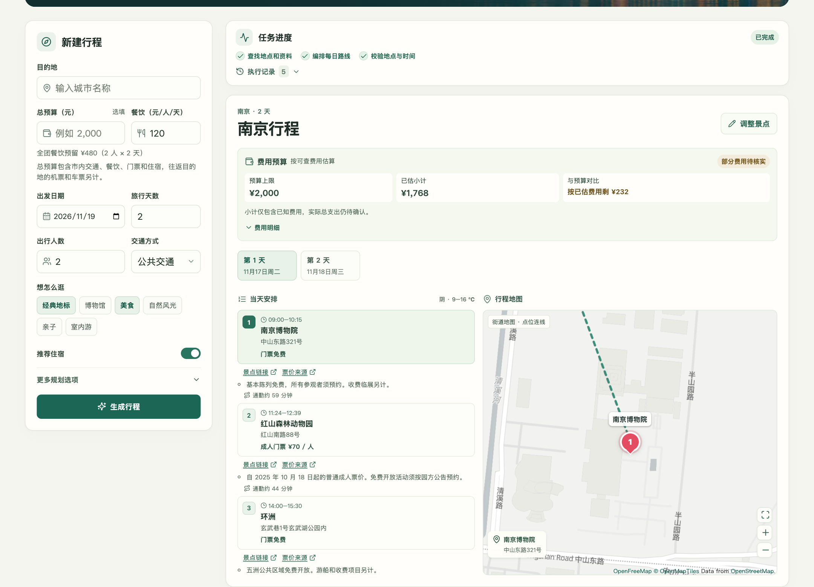
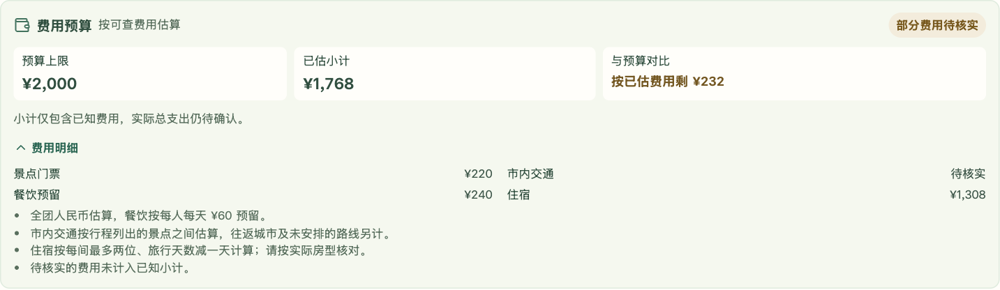
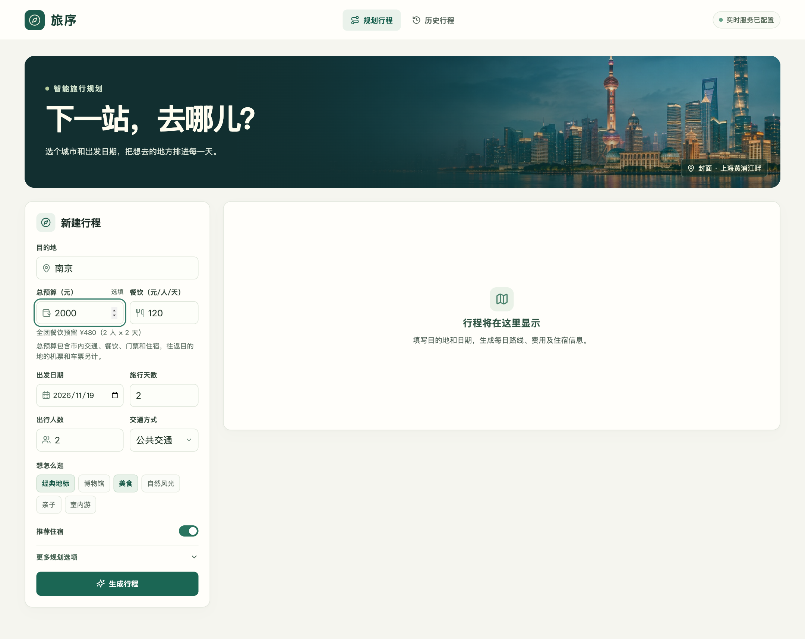
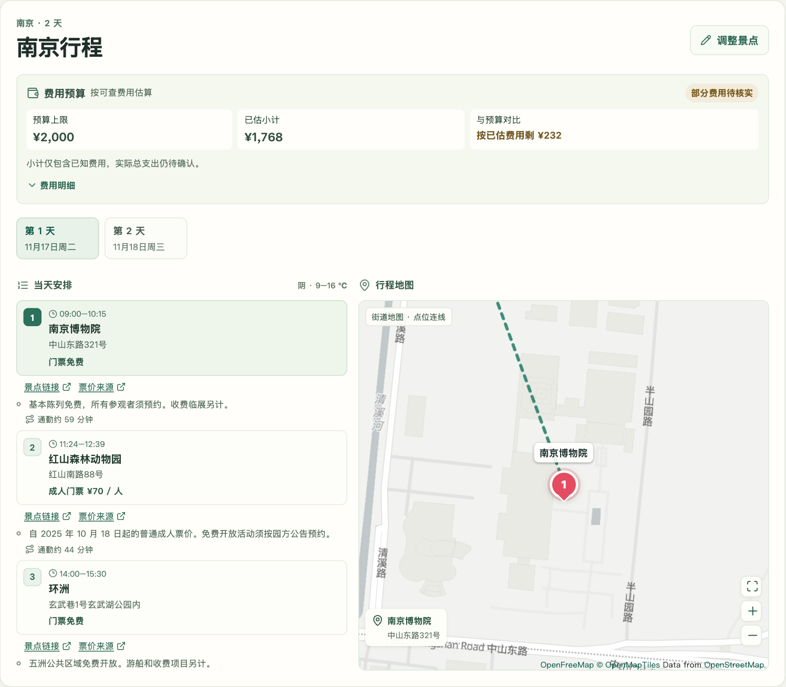
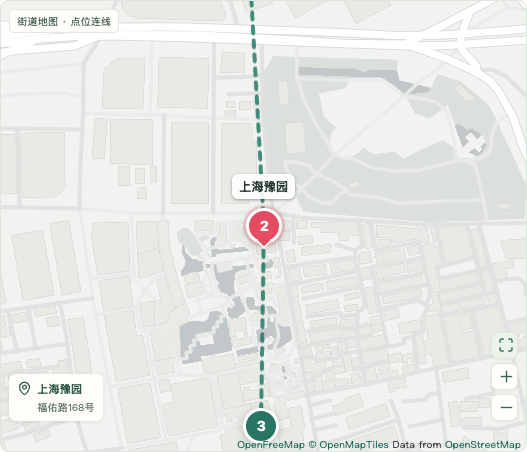
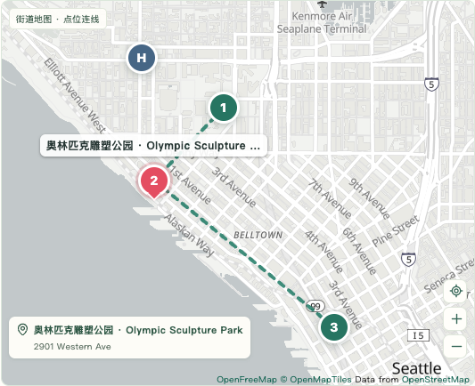
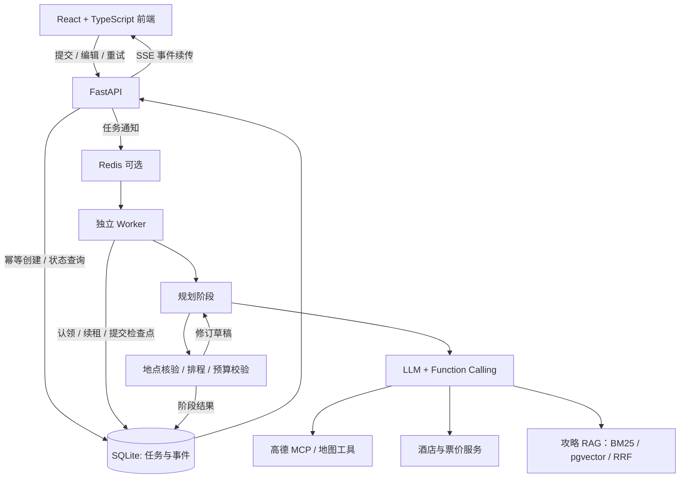

# 旅序 · Travel Planning Agent

> 基于真实地图工具、可核验价格和异步任务工作流的智能旅行规划助手。


[项目介绍](#项目介绍) · [系统架构](#系统架构) · [核心设计](#核心设计) · [评测](#评测) · [快速开始](#快速开始)

## 项目介绍

传统旅行问答容易生成不存在的地点、过期票价或无法执行的行程，也无法在长时间规划过程中持续反馈进度。旅序将 LLM 的规划能力与地图、天气、酒店及价格核验工具结合，生成可查看、可编辑、可追溯的多日旅行计划。

用户输入目的地、出行日期、人数、兴趣、交通方式和预算，系统后台规划行程，并在网页中显示：

- **每日行程**：景点、顺序、交通时间、住宿候选和天气建议。
- **地图可视化**：景点坐标、酒店位置及路线；缺少道路路线时明确显示点位连线。
- **预算明细**：门票、住宿、市内交通、餐饮估算，区分已核实报价与待核实费用。
- **进度与历史**：实时规划进度、阶段回放、失败重试、历史行程与景点顺序调整。

### 实际运行画面

**完成的行程**：南京两日旅行，双人预算 ¥2,000。已估费用 ¥1,768，占预算的 88.4%，预估余额 ¥232。


**预算明细**：住宿 ¥1,308、景点门票 ¥220、餐饮预留 ¥240，市内交通待核实。



<details>
<summary>查看更多界面：规划首页、行程详情与地图</summary>

**规划首页**



**行程与预算详情**



| 上海景点定位 | 西雅图景点与酒店点位 |
| :---: | :---: |
|  |  |

</details>


## 系统架构



FastAPI 接收请求并立即返回任务 ID，耗时的模型和工具调用交给 Worker。SQLite 保存任务状态、阶段检查点、租约及进度事件；Redis 是可选的通知加速层，Worker 仍能轮询 SQLite。前端通过 SSE 订阅进度，无需等待整条行程全部生成。

## 核心设计

### 1. Agent 工具调用与数据核验

模型通过 Function Calling 选择信息获取工具，使用 MCP 或兼容接口查询所需资料。模型的规划输出作为草案，由程序校验地点标识、坐标、路线、日期和预算等约束，再生成规范化的行程。

| 数据 | 服务与处理 |
| --- | --- |
| 景点、路线、天气 | 高德 MCP / REST，部分地点与天气支持公开地图和天气数据回退。 |
| 酒店 | RollingGo Hotel MCP；可选 Booking.com Demand API 和携程问道查询。未获得有效报价时显示待核实。 |
| 景点票价 | 搜索公开网页并抽取价格证据，按票种、日期与证据规则核验；缺失或证据不足时标记待核实。 |
| 攻略知识 | 内置 RAG 检索引擎，支持 BM25、pgvector 向量召回与 RRF 混合检索。配置向量服务后默认使用混合检索；不可用时降级到本地 BM25。Markdown 按标题、段落与句子切块，保留文档、标题和行号。 |

工具返回的事实与模型给出的推荐分别处理。POI、路线和价格以核验后的数据为依据，预算计算由程序完成。价格与库存以对应供应商最终页面为准。

### 2. 异步任务与故障恢复

| 机制 | 解决的问题 |
| --- | --- |
| 幂等键 | 重复提交同一请求时复用任务，避免重复规划。 |
| Worker 租约与续租 | 控制并发任务的归属，Worker 中断后可重新认领，回写时校验租约。 |
| 阶段 Checkpoint | 资料获取、草案及校验结果分阶段持久化，恢复时从最后一次成功提交继续。 |
| 指数退避与失败重试 | 临时故障自动重试；耗尽尝试后记录失败并允许继续。 |
| Redis + SQLite | Redis 提供通知，SQLite 保留任务事实；通知丢失时定期轮询仍能继续处理。 |
| SSE 事件序号 | 网络重连后按最后事件 ID 恢复进度流，也可回放历史。 |
| 行程版本 | 并发编辑时拒绝过期版本，景点调整后重算受影响的交通与费用。 |

### 3. 预算与行程可执行性

按用户指定的预算、日期、必去地点及天气约束调整景点和住宿；获取报价并按人数、夜数与房间数估算费用。改动景点后重新计算受影响路线和费用。不能核实的门票、住宿或交通金额显式标注，未计入费用的行程只展示已估小计，避免将它误认为完整总价。

### 技术取舍

| 技术 | 使用原因 |
| --- | --- |
| FastAPI | 将任务提交与执行分离，提供结构化 API 与 OpenAPI 文档。 |
| SQLite + 可选 Redis | 小规模部署仅需 SQLite；持久状态与队列通知分离，可逐步扩展 Worker。 |
| PostgreSQL + pgvector（可选） | 独立存储攻略向量与增量索引任务，内容哈希复用向量；BM25 与向量通过 RRF 融合排名。 |
| MCP + Function Calling | 将地图、酒店等业务工具接入统一的规划过程，模型按需选择信息来源。 |
| 确定性校验与规则排程 | 时间、费用、坐标、预算等约束需要可重复核验，不完全交给模型自由生成。 |
| React + TypeScript + MapLibre GL | 支持地图与行程联动、状态管理，以及服务端进度的实时呈现。 |

## 评测

项目内置 100 条固定评测任务，覆盖 10 类场景。每条任务分别运行三种策略（固定取数、模型自主工具、规则校验与修订），每种策略在正常和注入超时两种条件下各运行一次，共 600 次执行。

| 指标 | 已记录的离线结果 |
| --- | ---: |
| 行程生成成功 | 600/600 |
| 满足已定义的行程约束 | 600/600 |
| 地点核验通过 | 3,192/3,192 个景点 |
| 注入超时后的恢复 | 300/300 |
| 磁盘轨迹重放一致 | 600/600 |

上述为**固定数据和模拟模型条件下的工程评测**，验证了任务执行、约束校验、故障恢复和重放一致性；不能等同于公网真实模型的行程质量或服务可用率。这批实验三种策略的约束通过率相同，因此不声称某个策略在该测试集上显著更优。真实模型和工具的实验可用 `--mode live` 单独执行。

评测实现位于 [`evals/`](evals/)，GitHub Actions [CI 配置](.github/workflows/ci.yml) 包含 Python 测试、Redis 集成测试、完整离线评测和前端构建。

## 快速开始

环境：Python 3.11+、Node.js 20+。默认使用 SQLite，不要求额外启动数据库；真实旅行数据需要配置相应的服务密钥。

### 1. 安装并启动

从仓库根目录执行：

```bash
python3 -m venv .venv
source .venv/bin/activate
python -m pip install -e '.[dev]'
npm --prefix frontend ci
npm --prefix frontend run build
```

首次配置执行 `cp .env.example .env`，已有配置时无需重复复制。填写下列变量后运行 `python -m travel_agent`，同时启动 API 和独立 Worker。

| 环境变量 | 用途 |
| --- | --- |
| `TRAVEL_MODEL_BASE_URL` / `TRAVEL_MODEL_NAME` / `TRAVEL_MODEL_API_KEY` | 兼容 Chat Completions 的模型服务，需支持工具调用。 |
| `AMAP_MCP_KEY`（或 `AMAP_WEB_KEY`） | 地点、天气与路线查询。 |
| `ROLLINGGO_API_KEY` | 可选，实时酒店报价。 |
| `TRAVEL_QUEUE` / `TRAVEL_REDIS_URL` | 可选，使用 Redis 通知；默认 SQLite。 |
| `TRAVEL_GUIDE_DIR` | 可选，指定 Markdown 攻略资料目录；默认使用自带语料。 |
| `TRAVEL_GUIDE_RETRIEVAL` | `auto`（配置齐全时混合召回）、`lexical`、`vector` 或 `hybrid`。 |

打开 [http://127.0.0.1:8000](http://127.0.0.1:8000) 进入旅行规划页面；[http://127.0.0.1:8000/docs](http://127.0.0.1:8000/docs) 查看 API 文档。

攻略检索模块随项目一同安装。默认使用 `travel_agent/guide_data/` 中的 Markdown 语料，也可通过 `TRAVEL_GUIDE_DIR` 扩展自己的攻略库。BM25 模式无需额外服务。

### 2. 启用攻略向量与混合检索（可选）

在 `.env` 配置 `EMBEDDING_BASE_URL`、`EMBEDDING_MODEL`、`EMBEDDING_API_KEY`、`DATABASE_URL`，以及 `TRAVEL_GUIDE_RETRIEVAL=hybrid`。使用 Compose 时先设置独立的 PostgreSQL 口令，并确保 `DATABASE_URL` 与数据库配置一致。

```bash
python -m pip install -e '.[embedding]'
docker compose up -d postgres
python -m travel_agent.guides --require-mode hybrid
python -m travel_agent
```

Worker 启动时同步 Markdown 文件、处理增量索引任务；内容未变化时复用已有向量，检索时仅编码查询。配置不可用或索引未就绪时会在日志中明确降级至 BM25。调整攻略文件后重启 Worker 或预先运行索引准备命令再启动。已安装 PostgreSQL 与 pgvector 的本机环境，也可用 [本地数据库脚本](scripts/local_guide_postgres.py) 启动私有 socket 实例。

本地真实接入验收使用项目自带的两份 Markdown 攻略，9 个块全部就绪；BM25、纯向量及 RRF 混合检索均成功返回结果。重新同步未变化的语料时，文档嵌入接口调用次数为 0。这是对检索链路与缓存复用的验收，并非检索命中率评测。

### 3. 无需真实服务的本地评测

```bash
python -m pytest -q

python -m evals.run --mode fixture --require-success \
  --output .runtime/evaluation.json --trace-dir .runtime/eval-traces

python -m evals.run --replay-dir .runtime/eval-traces \
  --output .runtime/eval-replay.json
```

固定样本模式始终走本地 BM25，避免访问外部嵌入服务。配置模型及地图工具后，可以进行实况模式试跑：

```bash
python -m evals.run --mode live --limit 1 --profiles clean --strategies verified
```

如需分别启动 API 与后台 Worker，或配置酒店、票务、备用地图与 Redis，见 [开发与服务配置指南](DEVELOPMENT.md)。

## 仓库结构

```text
travel-planning-agent/
├── travel_agent/
│   ├── api.py                 # FastAPI、任务接口、SSE
│   ├── worker.py              # 后台任务、续租与重试
│   ├── store.py / queue.py    # SQLite 状态与通知层
│   ├── planner.py            # 规划阶段、工具调用与行程校验
│   ├── providers.py          # 地图与服务适配
│   ├── amap_mcp.py            # 高德 MCP
│   ├── rollinggo.py           # 酒店报价
│   ├── ticket_verification.py # 票价证据核验
│   ├── budget.py / pricing.py # 费用与预算计算
│   ├── guides.py / guide_data # 攻略检索与 Markdown 语料
│   └── rag_engine/           # 内置结构化切块与检索引擎
├── frontend/                 # React、TypeScript、地图与进度界面
├── evals/                    # 固定场景、指标、记录与重放
├── tests/                    # 业务逻辑及任务运行测试
├── docs/                     # 实际界面截图
├── compose.yaml              # 可选的独立 pgvector 数据库
└── .github/workflows/ci.yml   # 自动化测试与构建
```

## 数据与参考

- [高德 MCP 接入文档](https://lbs.amap.com/api/mcp-server/gettingstarted)
- [RollingGo Hotel MCP](https://github.com/RollingGo-AI/rollinggo-hotel-mcp)
- [Booking.com Demand API](https://developers.booking.com/demand/docs/getting-started/prerequisites)
- [OpenFreeMap](https://openfreemap.org/quick_start/) 与 [OpenStreetMap](https://www.openstreetmap.org/copyright)
- [完整开发与服务配置指南](DEVELOPMENT.md)

